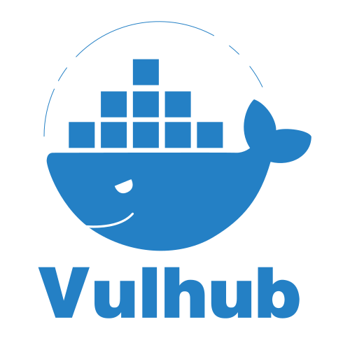

# Korean Vulhub (한글판)

취약한 도커 환경을 구축하여, 이해도를 높이고, 실습을 통해 보안 기술을 익히는 것을 목표로 합니다.

[Vulhub](https://github.com/vulhub/vulhub) (<https://vulhub.org/>) 을 참고하여, 다양한 컨테이너 기반의 취약한 환경을 구축합니다.

 

### Table of Contents

- **ActiveMQ** — Java 기반 오픈소스 메시지 브로커
    - [CVE-2016-3088](./ActiveMQ/CVE-2016-3088/README.md) — ActiveMQ fileserver 임의 파일 쓰기 → RCE
        - Contributor: [@Roronoawjd](https://github.com/Roronoawjd) | CVSS: 9.8 (NVD)

- **Apache HTTP Server** — 오픈소스 웹 서버
    - [CVE-2021-41773](./Apache/CVE-2021-41773/README.md) — Apache HTTP Server 2.4.49 경로 탐색을 통한 파일 노출
        - Contributor: [@decmoon05](https://github.com/decmoon05) | Risk Score: 9.8 (Reproducibility: 95%)

- **CouchDB** — Erlang 기반 오픈소스 문서 지향 NoSQL 데이터베이스
    - [CVE-2017-12635](./CouchDB/CVE-2017-12635/README.md) — CouchDB JSON 파서 불일치를 이용한 원격 권한 상승
        - Contributor: [@jason1343](https://github.com/jason1343) | CVSS: 9.8 (NVD)

- **Django** — Python 기반 웹 프레임워크
    - [CVE-2021-35042](./Django/CVE-2021-35042/README.md) — QuerySet.order_by() SQL Injection
        - Contributor: [@sj1226m](https://github.com/sj1226m) | CVSS: 9.8 (NVD)
    - [CVE-2022-34265](./Django/CVE-2022-34265_2/README.md) — Trunc()/Extract() SQL Injection
        - Contributor: [@KMINGON](https://github.com/KMINGON) | CVSS: 9.8 (NVD)

- **Express** — Node.js 웹 프레임워크
    - [CVE-2024-29041](./Express/CVE-2024-29041/README.md) — Express 오픈 리다이렉트 취약점
        - Contributor: [@j93es](https://github.com/j93es) | CVSS: 6.1 (NVD)

- **Elfinder** — PHP 기반 웹 파일 관리자
    - [CVE-2021-32682](./Elfinder/CVE-2021-32682/README.md) — ZIP 인수 삽입을 통한 원격 코드 실행
        - Contributor: [@Tjdmin1](https://github.com/Tjdmin1) | CVSS: 9.8 (NVD)

- **Flask** — Python 경량 웹 프레임워크
    - [SSTI](./Flask/SSTI/README.md) — Server Side Template Injection
        - Contributor: [@positiveWand](https://github.com/positiveWand) | CVSS: 9.8 (NVD)

- **Gradio** — Python 기반 ML 모델 웹 인터페이스 라이브러리
    - [CVE-2023-51449](./Gradio/CVE-2023-51449/README.md) — /file 엔드포인트 디렉터리 트래버설
        - Contributor: [@annseojin](https://github.com/annseojin) | CVSS: 7.5 (NVD)

- **GeoServer** — Java 기반 오픈소스 공간 데이터 서버
    - [CVE-2023-25157](./GeoServer/CVE-2023-25157_2/README.md) — GeoServer OGC 필터 SQL 인젝션
        - Contributor: [@moooooji](https://github.com/moooooji) | CVSS: 9.8 (NVD)

- **HugeGraph** — Apache 기반 오픈소스 그래프 데이터베이스
    - [CVE-2024-43441](./HugeGraph/CVE-2024-43441/README.md) — JWT 비밀 키 하드코딩으로 인한 인증 우회
        - Contributor: [@HanTul](https://github.com/HanTul) | CVSS: 9.8 (NVD)

- **Librsvg** — GNOME SVG 렌더링 라이브러리
    - [CVE-2023-38633](./Librsvg/CVE-2023-38633/README.md) — librsvg xi:include 디렉터리 탐색 파일 읽기
        - Contributor: [@EL55](https://github.com/EL55) | CVSS: 5.5 (NVD)

- **Libssh** — SSHv2 프로토콜 C 라이브러리
    - [CVE-2018-10933](./Libssh/CVE-2018-10933/README.md) — libssh 서버 state machine 인증 우회
        - Contributor: [@hhtboy](https://github.com/hhtboy) | CVSS: 9.1 (NVD)

- **MongoExpress** — MongoDB 웹 기반 관리 인터페이스
    - [CVE-2019-10758](./MongoExpress/CVE-2019-10758/README.md) — mongo-express 원격 코드 실행
        - Contributor: [@ilohas0021](https://github.com/ilohas0021) | CVSS: 9.9 (NVD)

- **MySQL** — 관계형 데이터베이스
    - [CVE-2012-2122](./MySQL/CVE-2012-2122/README.md) — MySQL Authentication Bypass
        - Contributor: [@baethwjd2](https://github.com/baethwjd2) | CVSS: 5.1 (NVD v2)

- **Next.js** — React 기반 풀스택 웹 프레임워크
    - [CVE-2025-29927](./Next.js/CVE-2025-29927/README.md) — Next.js 미들웨어 인가 우회
        - Contributor: [@idealinsane](https://github.com/idealinsane) | CVSS: 9.1 (NVD)

- **Nginx** — 고성능 웹 서버 / 리버스 프록시
    - [CVE-2017-7529](./Nginx/CVE-2017-7529/README.md) — Nginx Integer Overflow Vulnerability
        - Contributor: [@c0dep1ayer](https://github.com/c0dep1ayer) | CVSS: 7.5 (NVD)

- **Node** — JavaScript 런타임 환경
    - [CVE-2017-14849](./Node/CVE-2017-14849/README.md) — Node.js path.normalize() 디렉터리 탐색 취약점
        - Contributor: [@ssongk](https://github.com/ssongk) | CVSS: 7.5 (NVD)

- **PHP** — 서버 사이드 스크립트 언어
    - [CVE-2012-1823](./PHP/CVE-2012-1823/README.md) — php-cgi 인자 주입을 통한 원격 코드 실행
        - Contributor: [@kty121](https://github.com/kty121) | CVSS: 9.8 (NVD)

- **Python** — Python 런타임 환경
    - [CVE-2017-8291](./Python/CVE-2017-8291/README.md) — PIL(Pillow) GhostScript EPS 처리 RCE
        - Contributor: [@wjdgnsdl213](https://github.com/wjdgnsdl213) | CVSS: 7.8 (NVD)

- **Redis** — 인메모리 키-값 데이터베이스
    - [CVE-2022-0543](./Redis/CVE-2022-0543/README.md) — Lua 샌드박스 탈출을 통한 원격 코드 실행
        - Contributor: [@yeo0n](https://github.com/yeo0n) | CVSS: 10.0 (NVD)

- **Spring** — Java 엔터프라이즈 웹 프레임워크
    - [CVE-2022-22963](./Spring/CVE-2022-22963/README.md) — Spring Cloud Function SpEL 코드 주입
        - Contributor: [@foskingson](https://github.com/foskingson) | CVSS: 9.8 (NVD)
    - [CVE-2022-22965](./Spring/CVE-2022-22965/README.md) — Spring Framework RCE via Data Binding (Spring4Shell)
        - Contributor: [@ddddabi](https://github.com/ddddabi) | CVSS: 9.8 (NVD)
    - [CVE-2022-22978](./Spring/CVE-2022-22978/README.md) — Spring Security Authorization Bypass in RegexRequestMatcher
        - Contributor: [@sub0810](https://github.com/sub0810) | CVSS: 9.8 (NVD)

- **Struts2** — Java 기반 MVC 웹 프레임워크
    - [CVE-2018-11776](./Struts2/CVE-2018-11776/README.md) — Struts2 S2-057 URL 매핑 OGNL 표현식 주입 RCE
        - Contributor: [@ye11oc4t](https://github.com/ye11oc4t) | CVSS: 8.1 (NVD)
    - [CVE-2019-0230](./Struts2/CVE-2019-0230/README.md) — Struts2 S2-059 OGNL 표현식 주입 RCE
        - Contributor: [@hy30nq](https://github.com/hy30nq) | CVSS: 9.8 (NVD)

- **Tiki Wiki** — PHP 기반 오픈소스 CMS / Wiki
    - [CVE-2020-15906](./TikiWiki/CVE-2020-15906/README.md) — TikiWiki CMS Authentication Bypass → RCE
        - Contributor: [@haijun9](https://github.com/haijun9) | CVSS: 9.8 (NVD)

- **Tomcat** — Java 기반 오픈소스 웹 애플리케이션 서버
    - [CVE-2020-1938](./Tomcat/CVE-2020-1938/README.md) — Apache Tomcat AJP 파일 읽기 (Ghostcat)
        - Contributor: [@mythofsummer](https://github.com/mythofsummer) | CVSS: 9.8 (NVD)

 

### Report Evaluation

각 보고서는 Docker 환경과 제출된 PoC를 직접 재검증한 뒤 기록합니다.

- Reproducibility: 깨끗한 환경에서 제출물을 그대로 실행해 취약점이 재현되는 정도를 평가합니다.
- Risk (CVSS): 해당 CVE의 NVD 공개 점수를 참고용으로 표기하며, 재현성 평가와는 분리합니다.

세부 채점 기준은 과정 내부 기준을 따릅니다.
